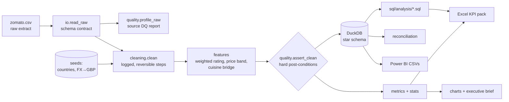

# Zomato Restaurant Market Analytics

[](https://github.com/ngin10/EDA-ZOMATO/actions/workflows/ci.yml)


A reproducible analytics pipeline for **9,551 restaurants in 15 countries**
(the Kaggle Zomato dataset). It started life as an exploratory Colab notebook
([`notebooks/00_original_colab_eda.ipynb`](notebooks/00_original_colab_eda.ipynb)) and was rebuilt
the way an analytics team would run it in production: validated inputs, logged cleaning,
a SQL star schema, statistical tests with effect sizes, and outputs for **Power BI, Excel and a
written executive brief**. All prices are normalised to **GBP**, and there is a dedicated
**UK market spotlight**.

```bash
pip install -e ".[dev]"
zomato-analytics demo          # full run on synthetic data, no download needed
zomato-analytics run           # full run on data/raw/zomato.csv (the real Kaggle file)
```

---

## Business questions

| # | Stakeholder question | Where it's answered |
|---|---|---|
| 1 | Where is the platform's footprint, and how do markets compare **in GBP**? | `market_overview`, `sql/analysis/01_country_kpis.sql` |
| 2 | How does the **UK** estate compare with the rest of the platform? | `uk_benchmark`, `uk_city_summary`, `05_uk_vs_platform.sql` |
| 3 | What is associated with a higher rating: **price, table booking, online delivery**? | `service_impact`, `stats.run_all` (with confounder controls) |
| 4 | Which cuisines lead, and where is **demand high relative to supply**? | `cuisine_performance`, `opportunity_matrix`, `06_cuisine_votes_pareto.sql` |
| 5 | **Can we trust the data?** | `dq_raw_profile`, `cleaning_log`, `dq_clean_checks`, reconciliation |

## What the original EDA got wrong (and this version fixes)

Profiling the real file showed problems that biased the first-pass notebook:

| Problem in source | Impact on naive analysis | Fix |
|---|---|---|
| **2,148 restaurants (22.5%) have rating `0.0`**, which means *not rated* | Mean rating dragged down; "Poor" cities are just unrated | Null + `is_rated` flag; ratings on rated only |
| **Costs in 12 currencies** mixed in one column (mean 1,199 vs median 400, max 800,000 IDR) | Cost comparisons meaningless across countries | Convert to GBP at 2017 FX (the data's vintage); use medians |
| **Currency labels are wrong or ambiguous** ("Dollar($)" covers 4 countries; Philippines tagged "Botswana Pula") | Wrong conversions | Currency taken from country code, label kept only for audit |
| **90.6% of rows are India** | Platform averages ≈ Indian averages; delivery effect confounded with country | Per-market reporting; India-only re-tests |
| Table booking concentrated in expensive restaurants | "Booking → higher rating" partly a price effect | Uplift reported within each price band |
| Garbled text (`ÛÁstanbul`), (0,0) coordinates, constant column | Broken labels and maps | Repair where reversible, flag the rest |

Details: [`docs/methodology.md`](docs/methodology.md).

## Architecture



## Outputs (`reports/`)

| File | For |
|---|---|
| `executive_summary.md` | Non-technical stakeholders. Every number is computed; findings are worded from the data |
| `zomato_kpi_pack.xlsx` | Excel users: one filterable tab per KPI table, SQL result and DQ check |
| `powerbi/*.csv` | Power BI / Tableau star schema. See [`docs/powerbi_dashboard_spec.md`](docs/powerbi_dashboard_spec.md) for the model, DAX measures and page design |
| `tables/*.csv` | Every analysis table, machine-readable |
| `figures/*.png` | Report charts |
| `zomato.duckdb` | The warehouse, for ad-hoc SQL (`duckdb reports/zomato.duckdb`) |
| `run_manifest.json` | Run audit: source, row counts, runtime, KPIs, file list |

## Using the real data

1. Download `zomato.csv` from [Kaggle: Zomato Restaurants Data](https://www.kaggle.com/datasets/shrutimehta/zomato-restaurants-data).
2. Save it as `data/raw/zomato.csv` (it is git-ignored and not redistributed).
3. `make run`, then open `reports/executive_summary.md`.

Without the file, `make demo` runs everything on a **synthetic generator** that
reproduces the source's schema and known defects. Demo outputs are clearly labelled
and must not be quoted as findings.

## Project structure

```
├── src/zomato_analytics/
│   ├── io.py            # read + schema contract (encoding fallback)
│   ├── schema.py        # column contract, valid ranges
│   ├── cleaning.py      # logged cleaning steps, GBP conversion, outlier flags
│   ├── features.py      # weighted rating, price bands, cuisine bridge
│   ├── quality.py       # source profiling + hard post-conditions
│   ├── metrics.py       # one function per business question
│   ├── stats.py         # Mann-Whitney / Kruskal / Spearman with effect sizes
│   ├── warehouse.py     # DuckDB star schema, SQL runner, reconciliation
│   ├── viz.py           # consistent chart system
│   ├── reporting.py     # Excel pack, CSVs, executive brief
│   ├── pipeline.py      # orchestration + run manifest
│   ├── sample_data.py   # synthetic data with the source's defects
│   └── cli.py           # `zomato-analytics run | demo | sample`
├── sql/
│   ├── marts/           # dimensions, fact, bridge
│   └── analysis/        # CTEs, window functions, QUALIFY, Pareto, reconciliation
├── data/seeds/          # country reference + FX-to-GBP (documented rates)
├── notebooks/
│   ├── 00_original_colab_eda.ipynb   # the first-pass EDA, kept for history
│   └── 01_analysis_walkthrough.ipynb # narrative walkthrough on the package
├── docs/                # data dictionary, methodology, Power BI spec, portfolio guide
├── tests/               # 31 tests, ~98% coverage, incl. SQL-vs-pandas parity
└── .github/workflows/ci.yml          # lint + tests + end-to-end demo on every push
```

## Development

```bash
make install   # pip install -e ".[dev]"
make lint      # ruff
make test      # pytest + coverage
make demo      # end-to-end on synthetic data
```

Assumptions and thresholds (minimum group size, Bayesian prior, outlier cut-off) live in
[`config.py`](src/zomato_analytics/config.py) and are explained in
[`docs/methodology.md`](docs/methodology.md).

## Documentation

- [Data dictionary & star schema](docs/data_dictionary.md)
- [Methodology, KPI definitions, limitations](docs/methodology.md)
- [Power BI dashboard specification (model, DAX, pages)](docs/powerbi_dashboard_spec.md)
- [Presenting this project for UK data analyst roles](docs/portfolio_guide.md)

## Licence

Code: MIT. Data: see the Kaggle dataset's licence. The raw data is not included in this repository.
